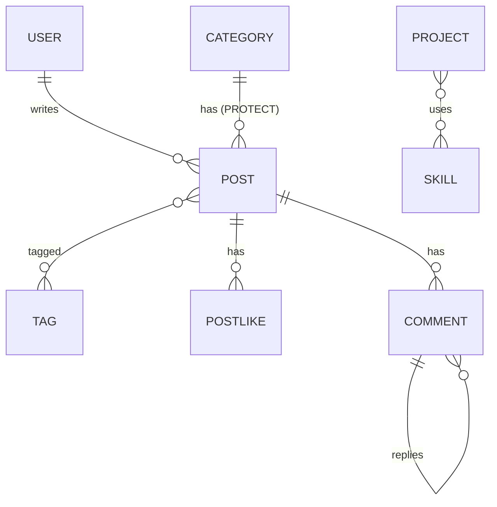

# DevFolio Backend: Portfolio + Blog REST API

A single-owner portfolio and blog API built with Django REST Framework. Visitors can read everything public, like posts, comment (with approval) and send contact messages. Only the owner (the superuser) can write.

- **Frontend repo:** https://github.com/NahinShanto/NahinShanto-portfolio-frontend
- **Postman collection:** [`postman_collection.json`](./postman_collection.json)
- **Live API:** _add the link here if deployed_

## Tech stack

- Python 3.10+, Django, Django REST Framework
- `djangorestframework-simplejwt` (JWT auth with refresh-token blacklist)
- `django-filter`, `django-cors-headers`, `Pillow`, `python-decouple`
- SQLite (PostgreSQL works by changing `DATABASES`)

## Features

- Single owner, **no registration endpoint** (`/api/auth/register/` returns 404)
- JWT login / refresh / logout (refresh token is blacklisted) / me / change password
- Profile (singleton), skills, experience, education, projects (slug lookup)
- Blog: categories, tags, posts with draft/published status, reading time, filters, search, ordering
- Like toggle per visitor (`X-Visitor-Id`), view counter that does not double count
- Comments with one level of replies and an owner moderation queue
- Contact messages with an owner inbox
- Owner dashboard stats computed with ORM aggregation
- Throttling, request-logging middleware, signals, image and PDF validation

## Setup

```bash
git clone https://github.com/NahinShanto/NahinShanto-portfolio-backend.git
cd NahinShanto-portfolio-backend
python -m venv venv
venv\Scripts\activate          # macOS/Linux: source venv/bin/activate
pip install -r requirements.txt
copy .env.example .env         # macOS/Linux: cp .env.example .env  (then edit the values)
python manage.py migrate
python manage.py createsuperuser
python manage.py runserver
```

API base: `http://127.0.0.1:8000/api/` · Django admin: `http://127.0.0.1:8000/admin/`

## Environment variables

| Variable | Example | Purpose |
|---|---|---|
| `SECRET_KEY` | `change-me` | Django secret key |
| `DEBUG` | `True` | Use `False` in production |
| `ALLOWED_HOSTS` | `127.0.0.1,localhost` | Comma separated hosts |
| `CORS_ALLOWED_ORIGINS` | `http://localhost:5173` | Frontend origin(s) allowed by CORS (whitelist, never allow all) |
| `THROTTLE_ANON_RATE` | `20/min` | Anonymous global throttle |
| `THROTTLE_COMMENT_RATE` | `5/hour` | Comment creation per IP |
| `THROTTLE_CONTACT_RATE` | `3/hour` | Contact form per IP |
| `THROTTLE_LIKE_RATE` | `30/min` | Like toggle |

## Content format

Post `content` is stored as **Markdown**. The frontend renders it with `react-markdown`.

## Authentication and the permission class

Login returns `access` and `refresh` JWTs. Send `Authorization: Bearer <access>` on owner requests.

Authorization lives in `coreProfile/permissions.py` and is enforced on the server, not in the frontend:

- `IsOwnerOrReadOnly`: GET/HEAD/OPTIONS are allowed for everyone. Any write requires `request.user.is_authenticated and request.user.is_superuser`.
- `IsOwner`: every method requires the owner (used for the moderation list, inbox, dashboard, auth/me, etc.).

A visitor gets `401` on writes, a normal non-superuser gets `403`.

## Endpoints

| Method | Endpoint | Access | Notes |
|---|---|---|---|
| POST | `/api/auth/login/` | Public | `{username, password}` returns `access`, `refresh`, `user` |
| POST | `/api/auth/refresh/` | Public | Rotates the refresh token |
| POST | `/api/auth/logout/` | Owner | Blacklists the refresh token |
| GET | `/api/auth/me/` | Owner | Restores the session |
| POST | `/api/auth/change-password/` | Owner | `{old_password, new_password}` |
| GET / PATCH | `/api/profile/` | Public / Owner | Singleton; PATCH supports avatar and resume upload |
| GET | `/api/skills/` | Public | `?category=`, `?is_featured=`, `?search=`, `?ordering=` |
| POST / PATCH / DELETE | `/api/skills/`, `/api/skills/<id>/` | Owner | |
| GET | `/api/experiences/`, `/api/education/` | Public | |
| POST / PATCH / DELETE | `/api/experiences/…`, `/api/education/…` | Owner | |
| GET | `/api/projects/` | Public | `?category=`, `?is_featured=`, `?tech=<id or name>`, `?search=`, `?ordering=`, 9 per page |
| GET | `/api/projects/<slug>/` | Public | |
| POST / PATCH / DELETE | `/api/projects/`, `/api/projects/<slug>/` | Owner | |
| GET | `/api/posts/` | Public | Published only. Owner may use `?status=DRAFT` or `?status=all`. `?category=<slug>`, `?tag=<slug>`, `?is_featured=`, `?search=`, `?ordering=`, 6 per page |
| GET | `/api/posts/<slug>/` | Public | Draft returns 404 for visitors. Includes `likes_count`, `comments_count`, `is_liked`, `related_posts` |
| POST / PATCH / DELETE | `/api/posts/`, `/api/posts/<slug>/` | Owner | |
| POST | `/api/posts/<slug>/like/` | Public | Toggle. Header `X-Visitor-Id` required (400 if missing) |
| GET / POST | `/api/posts/<slug>/comments/` | Public | GET returns approved, threaded comments (10 per page). POST creates an unapproved comment |
| GET | `/api/comments/` | Owner | Moderation list, `?is_approved=false`, `?post=<slug>` |
| PATCH / DELETE | `/api/comments/<id>/` | Owner | Approve / unapprove / delete |
| GET | `/api/categories/`, `/api/tags/` | Public | Each item has `posts_count` (published only) |
| POST / PATCH / DELETE | `/api/categories/…`, `/api/tags/…` | Owner | A category used by a post returns 400, not 500 |
| POST | `/api/contact/` | Public | Throttled |
| GET | `/api/contact/` | Owner | `?is_read=false`, 10 per page |
| PATCH / DELETE | `/api/contact/<id>/` | Owner | Mark read / delete |
| GET | `/api/dashboard/stats/` | Owner | One request, ORM aggregation |

## Models



Standalone models: `Profile` (singleton), `Experience`, `Education`, `ContactMessage`. Every model has `created_at` and `updated_at` except `PostLike`.

- **Profile singleton:** `save()` always uses `pk=1`, and the admin hides "Add" once a row exists.
- **Post:** `slug` is generated from the title, `reading_time` is computed from word count (about 200 words per minute), and `published_at` is set only the first time the status becomes `PUBLISHED`.

## View counter strategy

A post's `views_count` must not grow on every refresh (React 18 StrictMode also runs effects twice in development), so the guard is on the server:

1. The visitor is identified by the `X-Visitor-Id` header (falls back to the IP address).
2. `cache.add(key, ...)` with a 30 minute cooldown (`POST_VIEW_COOLDOWN_SECONDS`) is atomic, so only the first visit inside the window is counted.
3. The increment is a single `F("views_count") + 1` database update (no read-modify-save).
4. The owner's own visits are never counted.

The default `LocMemCache` is per process. Use Redis or the database cache in production.

## Throttling

DRF throttles with scopes (`ScopedRateThrottle`) plus the anonymous throttle. Rates are read from `.env`.

| Scope | Rate | Applies to |
|---|---|---|
| anon | 20/min | all anonymous requests |
| comment | 5/hour | creating a comment (per IP) |
| contact | 3/hour | contact form (per IP) |
| like | 30/min | like toggle |

## Middleware and signals

- `RequestLogMiddleware` logs every request as `METHOD /path -> status (xx ms)` and adds an `X-Response-Time` header.
- `post_save` on `Comment`: sends a "New comment awaiting approval" email (console email backend).
- `post_delete` on `Post` and `Project`: deletes the cover image file from disk.

## Validation highlights

Post title 5+ characters; a post cannot be published with under 100 characters of content or without a category; skill proficiency 1 to 100; experience dates (no future start, `end_date` rules with `is_current`); a project needs a live or GitHub URL; comment 5 to 1000 characters; contact message 10 to 2000; images max 2 MB (`.jpg`, `.jpeg`, `.png`, `.webp`); resume PDF only, max 5 MB.

## Testing

Import `postman_collection.json` into Postman and run it with the Collection Runner. It covers login, every public GET, an owner-only write for each resource, like toggle, comment create and approve, contact create, dashboard stats and the security checks (401, 403, register 404, drafts hidden). It creates its own test data and deletes it at the end.
